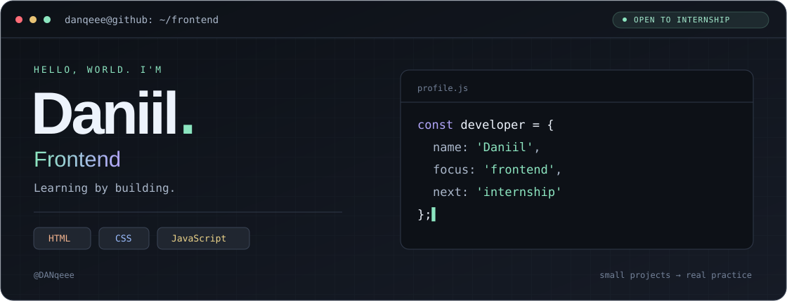

  

  <a href="#проекты">Проекты</a> ·
  <a href="#о-себе">О себе</a> ·
  <a href="https://vk.com/levi23321">Связаться</a>

## О себе

Привет! Я Даниил, студент. Развиваюсь во фронтенд-разработке и ищу стажировку.

Сейчас развиваю два личных проекта: **NOI** — спортивные цели и дневник сделок, **NoiSkriner** — исследовательский интерфейс рыночных данных. Оба проекта используют React и TypeScript и пока работают локально. Интересно, как из дизайна и логики получается понятный пользователю продукт.

**Технологии проектов:** React · TypeScript · JavaScript · HTML · CSS · Vite.

## Проекты

| Проект | Что посмотреть | Код |
| :--- | :--- | :--- |
| **NOI** | Спортивные цели, карта активности и личный дневник сделок | [Описание проекта](https://github.com/DANqeee/NOI) |
| **NoiSkriner** | Таблицы наблюдений, графики и исследование рыночных событий | [Описание проекта](https://github.com/DANqeee/NoiSkriner) |
| **Calculator** | Калькулятор на HTML, CSS и JavaScript · [Открыть демо](https://danqeee.github.io/calculator/) | [Репозиторий](https://github.com/DANqeee/calculator) |
| **Quote generator** | Учебный генератор цитат | [Репозиторий](https://github.com/DANqeee/quote-genarator) |

Для NOI и NoiSkriner опубликованы только витрины: описание, стек и изображения. Исходники и внутренние данные закрыты.

---

Открыт к frontend-стажировке и обратной связи по проектам. **[Написать мне →](https://vk.com/levi23321)**
